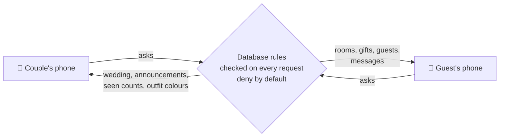

# Weddy 💍

**The wedding group chat the couple can't see.**

> **Problem:** Indian families plan a wedding in WhatsApp groups the couple can see. So surprises leak, two people buy the same gift, and the couple answers the same question 50 times.
>
> **Solution:** Weddy is one app per wedding with a wall in the middle. Guests plan in rooms the couple can never see, and the database (not the phone) enforces the wall.

📱 iPhone app (Expo) · 🛠️ Built in one day at Festive Hacks by WeMakeDevs, BIEC Bengaluru, 25 Nov 2026

<!-- SCREENS: add 3 screenshots here after recording, e.g.

  
  
  

-->

## The problem

Families want to plan things together for the couple, but the only tool they have is one the couple can see.

| What goes wrong | Why it happens |
| --- | --- |
| **Surprises leak** | The couple is in, or close to, every group. |
| **Gifts repeat** | Nobody can see what others are buying. |
| **The couple becomes the help desk** | The same "what time, what colour, which venue" questions, again and again, often from elders who don't read English. |

## What Weddy does

| Feature | How it works | Fixes |
| --- | --- | --- |
| **Join by invitation QR** | Scan the QR on the invitation, pick side, relation and language. No approval queue for 300 guests. | Lets 300 guests in without the couple approving each one |
| **Hidden surprise rooms** | Any guest creates one. Opens only with the phone's Face ID. Screenshots blocked. The couple never learns it exists. | Surprises leak |
| **Gifts room** | Claim a gift. Everyone sees "claimed", nobody sees by whom. | Gifts repeat |
| **AI helper** | Write or say a gift that's already taken, and only you get a private note with 3 unclaimed ideas. | Gifts repeat |
| **Announcements** | The couple posts once. Each guest reads it in their own language, or taps 🔊 Listen. The couple sees only "Seen by N", never names. | Couple is the help desk |
| **Outfit colours** | The couple sets colours per function; guests see swatches with colour names in their language. | Couple is the help desk |
| **Vendor room** | Vendors see only their own room and announcements marked "for vendors". | Vendors out of sync |

## How the wall works

- **The server decides, not the app.** Every "who sees what" rule is Postgres row-level security in [`supabase/migrations/0001_init.sql`](supabase/migrations/0001_init.sql). The couple's phone never receives rooms, guests, gifts or messages, so there is nothing hidden in the app to dig out.
- **The couple can't sneak in as a guest.** Their phone numbers and phones go on a block list when the wedding is created.
- **Guests can check it themselves.** "👀 See what the couple sees" shows the couple's exact screen.

## Sponsor tech

| Sponsor | What it does in Weddy | Code |
| --- | --- | --- |
| **Sarvam AI** | Translates announcements and messages into each guest's language (`mayura:v1`), reads them aloud (`bulbul:v3`), turns voice notes into text (`saaras:v4`) so the helper catches a duplicate gift even when an elder speaks, and powers the helper (`sarvam-105b`). All calls go through one server function, so the key never lives on a phone. Answers are cached, so the same translation is never paid for twice. | [`supabase/functions/ai/index.ts`](supabase/functions/ai/index.ts) |
| **Flagsmith** | Live switches, no new app build: `helper_on` turns the AI helper off everywhere in about 30 seconds; `sarvam_live` switches between free sample answers and real Sarvam; `translate_mode` picks tap-to-translate or auto. Read by both the app and the server. Privacy rules are never behind a flag. | [`src/lib/flags.ts`](src/lib/flags.ts) |
| **NudgeBee** | Planned, not built yet. | - |

One page per sponsor: [`docs/sponsors/`](docs/sponsors/). The whole app on one page: [`docs/HOW-IT-WORKS.md`](docs/HOW-IT-WORKS.md).

## How it's built

- **App:** Expo SDK 58 (React Native) + TypeScript, running on iPhone.
- **Backend:** Supabase. Postgres with row-level security (the wall), Realtime (live rooms), Auth, and one Edge Function (`ai`).
- **AI:** Sarvam AI. **Switches:** Flagsmith.

| Folder | What's inside |
| --- | --- |
| `App.tsx`, `src/screens/` | The iPhone screens |
| `src/lib/` | Supabase client, Flagsmith switches, AI calls, sign-in |
| `supabase/migrations/` | The database and the wall rules |
| `supabase/functions/ai/` | Sarvam calls and the AI helper |
| `docs/` | How Weddy works, sponsor pages |

## Status at submission

| Part | Status |
| --- | --- |
| The wall, QR join, surprise rooms, gifts, announcements, outfit colours, vendor room | ✅ Built |
| Sign-in | Phone + code screens built. The code check is a placeholder (code `123456`) until a provider is picked: [`src/lib/verify.ts`](src/lib/verify.ts) |
| AI helper (duplicate-gift catch) | Draft built in code, not live yet (the server function isn't deployed) |
| Sarvam AI live | Built in code, not deployed yet. Until then the app shows sample answers |
| Flagsmith switches | Built in code (app and server). Flags not created yet, so the defaults are used |
| NudgeBee | Planned, not built yet |

## Run it

1. Supabase SQL editor: run `supabase/migrations/0001_init.sql`, then `0002_grants.sql`.
2. Supabase, Authentication, Sign In / Providers: turn **on** the Email provider, and turn **off** "Confirm email" (both needed by the placeholder sign-in).
3. Supabase Edge Function secrets: `SARVAM_API_KEY`, `FLAGSMITH_ENV_KEY`. Deploy: `npx supabase functions deploy ai --project-ref <ref>`.
4. Flagsmith flags: `helper_on` (on), `sarvam_live` (off while building), `translate_mode` (value `tap` or `auto`).
5. Copy `.env.example` to `.env` and fill it in. Then `npm install` and `npx expo start --tunnel`, and scan the QR with the iPhone camera (Expo Go app).

## What Weddy will never do

- Show the couple a room, a guest's name, or who gave what.
- Tell anyone who claimed a gift, or what it cost.
- Push spending, brands or ads.
- Show message content on a lock screen.

## What's next

1. Talk to 3 or 4 couples marrying this season, and their families, to check they trust the wall.
2. Real phone sign-in with a code by SMS or WhatsApp.
3. A day-of brief: vendors fill it in together, and the couple sees only the final brief.
4. Rooms deleted a few days after the wedding, by default.

---

Built by [Paveen](https://github.com/P-aveen06) at Festive Hacks by WeMakeDevs.
