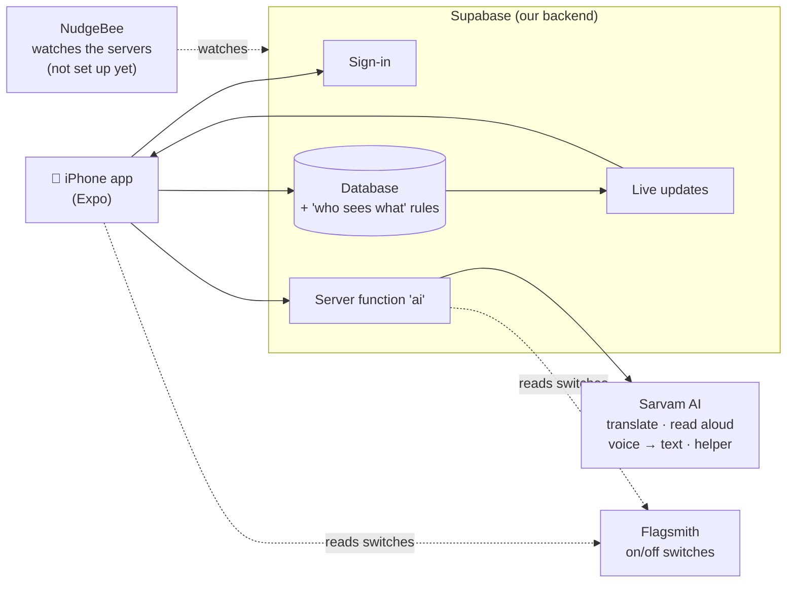

# How Weddy works

**The problem:** families plan weddings in WhatsApp groups the couple can see. Surprises leak, gifts repeat, vendors get mixed messages.

**The idea:** one app with a wall. Guests plan behind it. The couple can't see past it.

## The picture

**Key point for judges:** the phone never decides what the couple can see. The database does, on every request. The couple's phone simply never receives rooms, gifts, names or messages.

## Feature by feature

| Feature | Status |
| --- | --- |
| Sign-in | Draft, waiting for Paveen's OK (code check is a placeholder) |
| Couple creates the wedding | Built |
| Guest joins by invitation QR | Built |
| The wall (who sees what) | Built and tested |
| Default rooms | Built |
| Surprise rooms | Built |
| Gifts | Built |
| AI Helper (gift check) | Draft, waiting for Paveen's OK |
| Announcements | Built |
| Outfit colours | Built |
| Flagsmith switches | Built in code, flags not created yet |
| NudgeBee | Not started |

### Sign-in (draft)
1. Type your phone number.
2. Type the code. **Placeholder:** the code is always `123456` until we pick a real code provider.
3. You're in. Same number = same person on any phone.

### Couple creates the wedding
1. Bride or groom taps "Create our wedding" and enters the partner's number.
2. Both numbers and this phone go on the **couple block list**.
3. The partner gets a private couple code. It only works for their number.
4. Partner joins → the wedding goes **live** → the invitation QR appears.

### Guest joins
1. Scan the QR on the invitation.
2. Sign in, then pick **side**, **relation** and **language**.
3. In. No quiz, no approval. Couple numbers are refused here.
4. Other guests see "Name · side · relation" and can **flag** a stranger. Two people from the same side can clear a flag.

### The wall: who sees what

| | Couple | Guest | Vendor |
| --- | --- | --- | --- |
| Announcements | ✅ (posts them, sees "Seen by N") | ✅ | Only "for vendors" |
| Outfit colours | ✅ (edits them) | ✅ | ❌ |
| Gifts, Dress code rooms | ❌ | ✅ | ❌ |
| Surprise rooms | ❌ never knows they exist | Only if added | ❌ |
| Guest list | ❌ | ✅ | ❌ |
| Who claimed a gift | ❌ | ❌ (only "claimed") | ❌ |

### Default rooms
- When the wedding goes live: **Gifts**, **Dress code**, **Vendors**.

### Surprise rooms
1. Any guest creates one. It's hidden from everyone else.
2. Members add people already in the wedding. The room sees "Priya added Karthik".
3. Invite is soft: Join or "No thanks" (quiet).
4. Opens only with the phone's Face ID / passcode. Screenshots are blocked.
5. Owner can remove quietly, hand over, and tap "Surprise done 🎉".

### Gifts + AI Helper (draft)
1. Guests add gift ideas and tap **Claim**. Everyone sees "claimed", nobody sees by whom.
2. A guest writes or says (voice note) "I'll bring a silver lamp".
3. Sarvam turns voice into text and spots the gift.
4. If it's taken, **only that guest** sees: "Someone already has this covered 🎁" + 3 unclaimed ideas with Claim buttons, in their language.

### Announcements
1. The couple posts once.
2. Each guest reads it in their own language (Sarvam), with a 🔊 Listen button.
3. The couple sees only "Seen by 12", never names.

### Outfit colours
1. The couple picks swatches per function (up to 3 each).
2. Guests see the colour card with colour names in their language.
3. Saving sends one short announcement.

### Flagsmith switches
| Switch | What it does |
| --- | --- |
| `helper_on` | Turns the helper off everywhere in ~30 seconds |
| `sarvam_live` | Off = free sample answers while building. On = real Sarvam |
| `translate_mode` | `tap` = Translate button, `auto` = already translated |

## Where the code lives
- `App.tsx`, `src/screens/` → the iPhone screens
- `supabase/migrations/` → database + the wall rules
- `supabase/functions/ai/` → Sarvam calls and the helper
