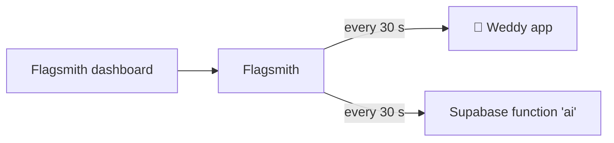

# Flagsmith in Weddy

**Problem it solves:** a wedding happens once. If the app misbehaves during the mehendi, there's no time for an App Store update, and the family goes back to WhatsApp.

**In one line:** Flagsmith lets us change how Weddy behaves in seconds, from a dashboard, without a new app build.

## The switches

| Switch | What it does | Starts at |
| --- | --- | --- |
| `helper_on` | Turns the AI helper off everywhere, in about 30 seconds | On |
| `sarvam_live` | Off = free sample answers while building. On = real Sarvam | Off while building, on for the demo |
| `translate_mode` | `tap` = guests tap Translate. `auto` = messages arrive already translated | `tap` |

## How it works

1. We flip a switch on the Flagsmith dashboard.
2. Phones and our server both check Flagsmith every 30 seconds.
3. Both obey, so switching the helper off stops it on screen **and** on the server.
4. If Flagsmith can't be reached, the app uses safe built-in defaults.

## Safety rules

- **Privacy is never behind a switch.** Blocking the couple, blank lock-screen notifications and deleting rooms after the event are fixed in the code.
- Flagsmith only sees a random member code. Never a name or phone number.

## Demo moment

On the Flagsmith dashboard we switch `helper_on` off. Within half a minute the helper is gone from both phones. We switch it back on.

## What we don't use it for

- Anything about the couple's privacy
- Targeting single guests, families or sides
- Anything that pushes spending
