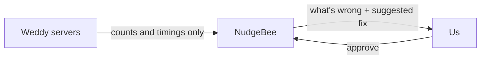

# NudgeBee in Weddy

**Problem it solves:** Weddy's busiest moment is the worst moment to fail. When the couple shows the invitation QR, a hall full of relatives joins within minutes. If the app stalls then, families decide "this doesn't work" and go back to WhatsApp.

**In one line:** NudgeBee watches Weddy's servers so a team of one can spot and fix trouble during the join rush.

**Status:** planned. Paveen signed up for NudgeBee on 25 Nov 2026. Nothing is connected yet.

## What it will watch

| What | Why it matters |
| --- | --- |
| Joins per minute and failed sign-ins | A failed first join sends the family back to WhatsApp |
| Sarvam errors and slow replies | Without translations, elders lose the plan |
| Server restarts, memory, CPU | A crashing server breaks everything at once |

## How it fits

1. NudgeBee watches the servers.
2. If something strains, it explains what's wrong and why, and suggests a fix.
3. A person approves every fix.

## Safety rules

- Guests and the couple never see NudgeBee.
- It sees counts, timings and error codes only. Never message text, names, phone numbers or room names.
