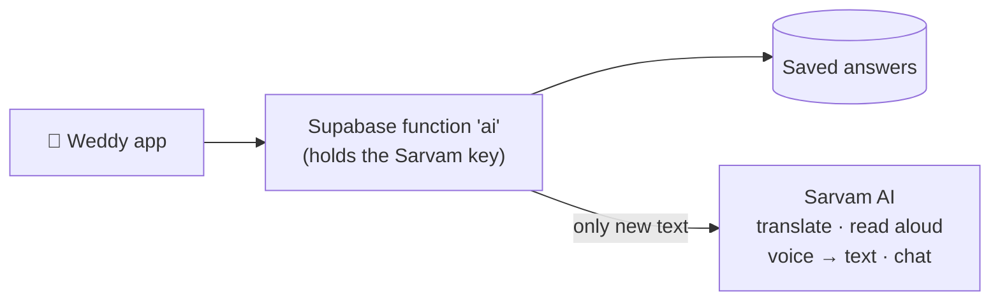

# Sarvam AI in Weddy

**Problem it solves:** many relatives read Tamil, Kannada or Hindi, or only talk in voice notes. If they can't read the plan, someone forwards it on WhatsApp, and the couple sees it there.

**In one line:** Sarvam lets every relative read and hear the plan in their own language.

## Where you see it

| Moment | Who | What they see |
| --- | --- | --- |
| Couple posts an announcement | Every member | The announcement in their own language, with a 🔊 Listen button |
| Reading a room message | Room members | **Translate** and **Listen** buttons under each message |
| Sending a voice note | Room members | The voice note written out as text |
| Voice note mentions a gift that's taken | Only the sender | A private tip from the helper, in their language |

## How it works

1. The phone never talks to Sarvam directly. It asks our server function.
2. The server checks saved answers first. Same text + same language = paid once.
3. Only new text goes to Sarvam.
4. If Sarvam fails, the guest sees the original with "Translation not available right now". It never guesses.

## Sarvam models we use

| Job | Sarvam model |
| --- | --- |
| Translate | Mayura |
| Read aloud | Bulbul |
| Voice note → text | Saaras |
| Helper chat (understands Hinglish, Tanglish) | Sarvam 105B |

## Cost

- While building: a Flagsmith switch (`sarvam_live`) keeps Sarvam off and returns sample answers. ₹0.
- Demo: about ₹45 of the ₹100 free credit.
- 40 guests opening the same announcement = **1** Sarvam call.

## Demo moment

<!-- DEMO LANGUAGES: waiting for Paveen -->
An aunt set to Tamil records a voice note: "I'll bring a silver lamp." A cousin already claimed it. Only the aunt gets a polite Tamil tip: it's taken, here are 3 unclaimed ideas.

## What we don't use it for

- Live call translation or voice cloning
- Summaries of rooms (one forward away from the couple)
- Writing messages for guests
